# Secure Hybrid Admin Lab: Azure Identity, WireGuard Tunnel and Local GPU LLM

A hands-on lab built to understand, hands-on, how a set of core cloud and infrastructure technologies actually work together: identity and access management, network security, VPN tunneling, TLS/PKI, container orchestration, monitoring/logging, and secretless authentication. Azure provides identity, governance, a hardened gateway VM, monitoring and logging. An on-premises (home) GPU workstation runs a local LLM stack. The two are joined by an encrypted WireGuard tunnel.

Everything was built **manually through the Azure portal and the Linux command line, with no Terraform or other automation**

> All identifiers in this document (tenant name, subscription, public IPs, keys, emails) are redacted or replaced with placeholders.

---

## Architecture

```
                         Internet
                            |
                 UDP 51820 only, from my home IP
                            |
                  +---------------------+
                  |   Azure VM (Sweden) |   WireGuard hub  10.10.0.1
                  |   Ubuntu 24.04      |   Caddy (HTTPS, internal CA)
                  |   NSG + Monitor     |   Azure Monitor Agent
                  +---------------------+
                     |               |
        encrypted WireGuard tunnel (10.10.0.0/24)
                     |               |
          +----------------+   +--------------------+
          | WSL2 Ubuntu    |   | Windows PC         |
          | 10.10.0.2      |   | 10.10.0.3          |
          | Docker:        |   | Chrome (browser)   |
          |  Ollama (GPU)  |   +--------------------+
          |  Open WebUI    |
          | RTX 2080 Super |
          +----------------+

Browser -> https://10.10.0.1 -> Caddy on the VM -> tunnel -> Open WebUI on the PC
```

Logs and metrics flow from the VM to a Log Analytics workspace:

```
VM (syslog + metrics) -> Azure Monitor Agent -> Data Collection Rules -> law-seclab-01 (KQL, alerts)
```

**Addressing plan**

| Node | Tunnel address | Role |
|---|---|---|
| Azure VM | 10.10.0.1 | Hub, reverse proxy |
| WSL workstation | 10.10.0.2 | Runs the LLM stack |
| Windows PC | 10.10.0.3 | Client (browser) |

The tunnel range is deliberately separate from the home LAN and Azure's internal network to avoid overlaps.

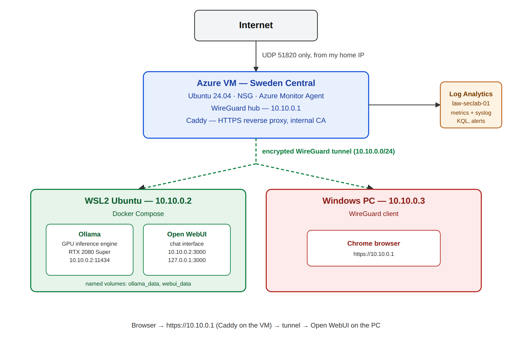

---

## 1. Identity and governance (Microsoft Entra ID and Azure RBAC)

**Concepts:** the tenant is the directory of identities, the subscription is the billing boundary, and the resource group is a labelled container for one project. RBAC assigns a role (a bundle of permissions) to a group at a scope.

- Dedicated resource group `rg-seclab-weu`, tagged `project = seclab`.
- Three cloud-only test users (helpdesk, sysadmin, auditor) and three matching **security groups**. Permissions go to groups, never to individual people.
- Role assignments at resource-group scope:

| Group | Role | Reason |
|---|---|---|
| `sg-auditors` | Reader | Can view everything, change nothing |
| `sg-sysadmins` | Contributor | Can manage resources, cannot grant access |
| `sg-helpdesk` | **Helpdesk VM Operator** (custom) | Can view and start, restart or deallocate VMs, nothing else |

- **Custom role** built from scratch, with only five actions: VM `read`, `instanceView/read`, `start`, `restart` and `deallocate`. Starting from zero permissions is the safest way to build a least-privilege role.
- I tested each role by signing in as each user in a private browser window and checking what the portal allowed.
- The operator account (me) holds Owner at subscription scope. Staff groups only hold narrow roles at resource-group scope.
- **System-assigned managed identity** enabled on the VM. It gives the VM its own Entra identity with no stored password or key, tied to the VM's lifecycle.

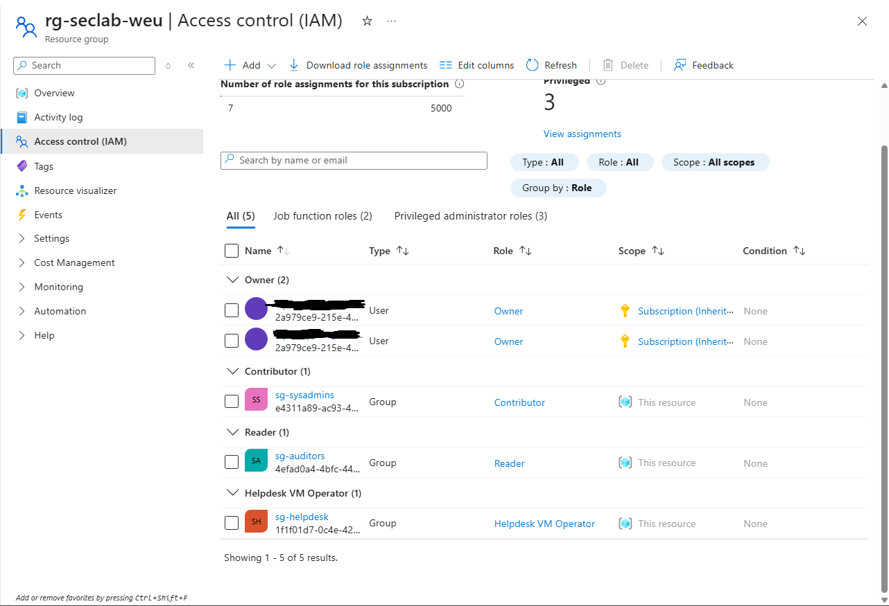
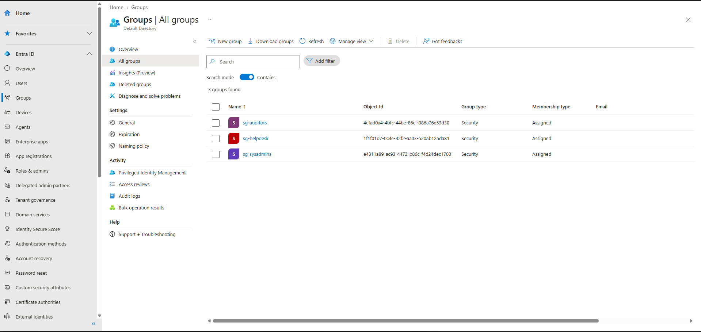
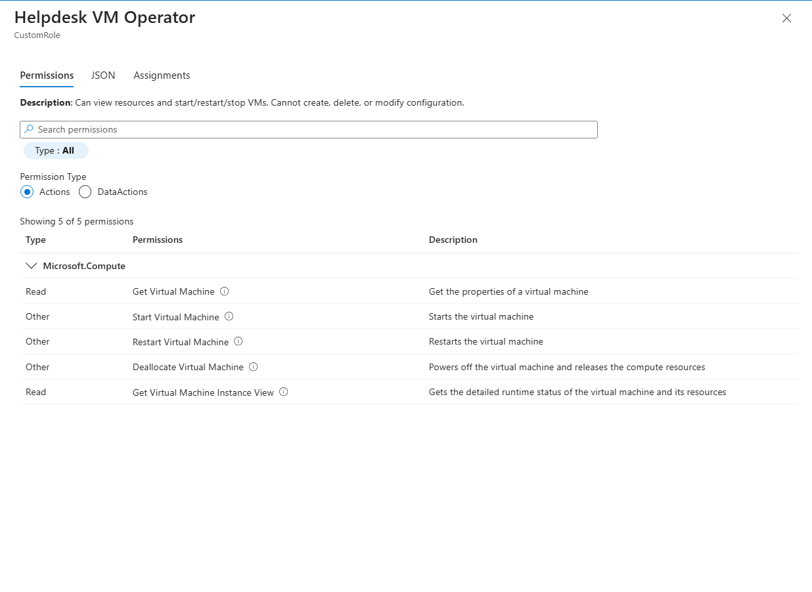

## 2. Compute and network perimeter

- Ubuntu Server 24.04 LTS VM `vm-seclab-01`, size **B2ats_v2**, Sweden Central, **SSH public key authentication only** (no passwords).
- The private key is stored outside any repository with owner-only permissions (`chmod u=rw,go=`).
- The Network Security Group is a stateful allow/deny rule list attached to the network interface. It is the cloud equivalent of basic firewall rules, without deep packet inspection.
- **Final inbound rule set:** only `Allow-WireGuard-MyIP` (UDP 51820, source = my home IP `/32`). Everything else falls through to Azure's default deny. SSH, the web UI and the Ollama API are reachable only through the tunnel.
- Budget alert configured in Cost Management before anything was deployed. The VM is deallocated (Stop in the portal) whenever it is not in use.

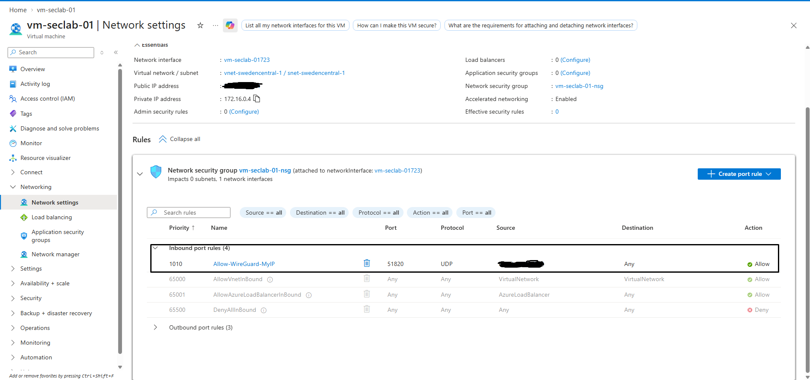
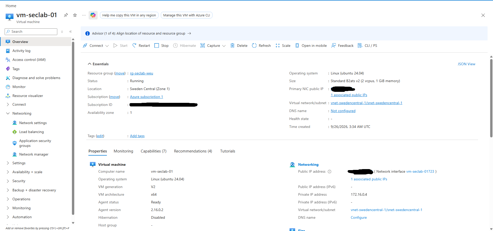

## 3. Monitoring (Azure Monitor)

- VM monitoring enabled with **OpenTelemetry metrics** (CPU, memory, disk, network, per-process) and classic log-based metrics into `law-seclab-01`.
- Recommended alert rules enabled: VM availability below 100% and guest OS metric rules, notifying by email.
- A baseline of idle CPU and memory is visible on the VM's Monitor page.

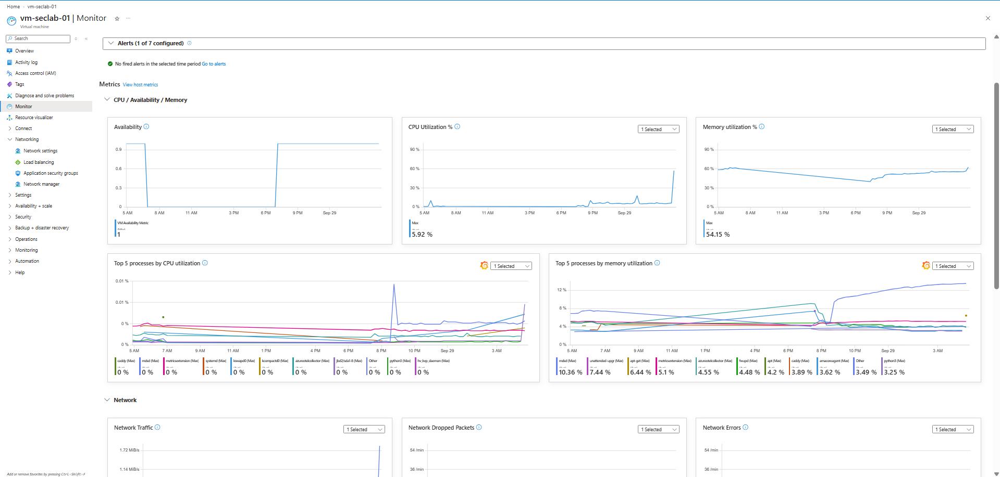

## 4. Logging (Data Collection Rule into Log Analytics)

- Data Collection Rule `dcr-seclab-syslog`, platform Linux, scoped to `vm-seclab-01`.
- Facilities collected: `LOG_AUTH`, `LOG_AUTHPRIV`, `LOG_DAEMON` at minimum level `LOG_INFO`. This keeps SSH and sudo events and service messages while controlling volume and cost.
- Destination: workspace `law-seclab-01`. Data is searchable with KQL in the `Syslog` table.

Queries used:

```kusto
// All recent events
Syslog
| where TimeGenerated > ago(1h)
| take 20

// My successful key-based SSH logins
Syslog
| where ProcessName == "sshd" and SyslogMessage has "Accepted publickey"
| project TimeGenerated, SyslogMessage
| order by TimeGenerated desc

// Failed pre-authentication attempts over time
Syslog
| where ProcessName == "sshd" and SyslogMessage has "preauth"
| summarize attempts = count() by bin(TimeGenerated, 10m)
| order by TimeGenerated desc

// Who is probing the VM
Syslog
| where ProcessName == "sshd" and SyslogMessage has "preauth"
| extend SourceIP = extract(@"user \w+ (\d+\.\d+\.\d+\.\d+)", 1, SyslogMessage)
| summarize attempts = count() by SourceIP
| order by attempts desc
```

Metrics answer "is it healthy?", logs answer "what happened?".

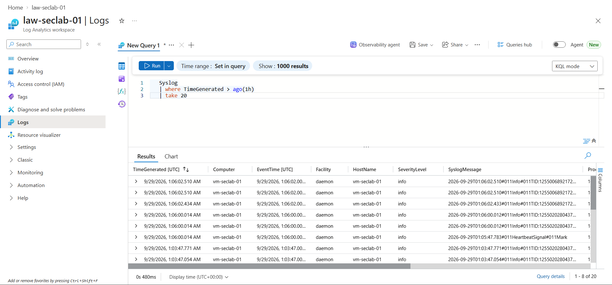

## 5. Hybrid connectivity (WireGuard)

- **Hub-and-spoke** design: the VM is the hub, and each client (WSL, Windows) is a peer that only talks to the hub.
- Each device has its own key pair. A config file has one `[Interface]` (this machine) and one `[Peer]` per trusted device. `AllowedIPs` acts as both a routing rule and an ingress filter.
- Clients use `PersistentKeepalive = 25` because they sit behind home NAT. Only the client initiates, so no ports are opened on the home router.
- The tunnel interface is `wg0`, created by `wg-quick up wg0`. The VM enables it at boot with `systemctl enable wg-quick@wg0`.
- Adding a user means adding one `[Peer]` block on the VM and applying it with `wg syncconf`, without dropping existing sessions.
- The Windows PC has its own WireGuard client, because the WSL tunnel exists only inside WSL and Windows has no route to it.

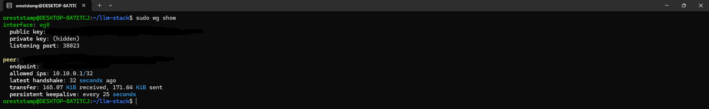
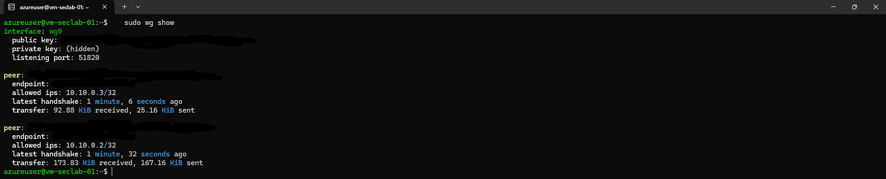

## 6. Local GPU LLM stack (Docker Compose)

- Windows GPU driver with WSL2 GPU passthrough, verified with `nvidia-smi` on the host and inside a container (`docker run --gpus all ... nvidia-smi`).
- `docker-compose.yml` defines two services:
  - **Ollama**: the inference engine, with a GPU reservation. It downloads and runs models and exposes an API.
  - **Open WebUI**: the browser chat interface, talking to Ollama by service name over Compose's internal network.
- Two **named volumes** keep the downloaded model (`ollama_data`) and the chat data (`webui_data`) alive when a container is recreated. `docker compose stop` never loses data, but `down`, an image update or `docker rm` recreates containers and would lose it.
- Model used: Llama 3.2 (3B), which fits comfortably in 8 GB of VRAM.
- Images are used as published, so no Dockerfile was needed. Compose orchestrates existing images. The `latest` tag is convenient, but pinning versions would be better for reproducibility.

**Port binding (least privilege for the network):**

```yaml
# Before: listens on every interface
ports:
  - "3000:8080"

# After: only loopback and the tunnel address
ports:
  - "127.0.0.1:3000:8080"   # my browser on this machine
  - "10.10.0.2:3000:8080"   # the tunnel
# Ollama: only "10.10.0.2:11434:11434"
```

Ollama's API has no authentication, so it must not be reachable on every interface. This creates an ordering dependency: `wg0` must exist before Docker can bind `10.10.0.2`.

**Start order:** `sudo wg-quick up wg0`, then `docker compose up -d`, then wait for `(healthy)` in `docker ps`.

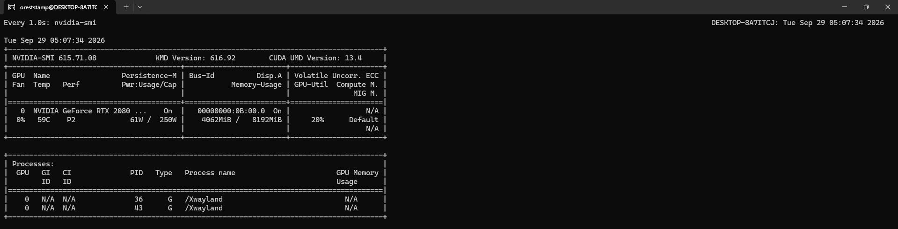
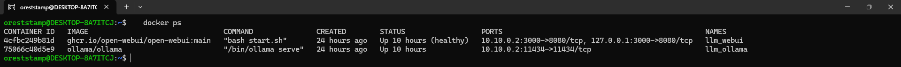
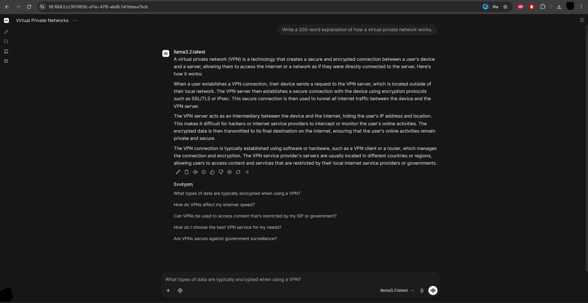

## 7. HTTPS reverse proxy and certificate lifecycle (Caddy)

- Caddy runs on the VM, bound only to the tunnel address, and forwards to Open WebUI on the workstation:

```
https://10.10.0.1 {
	bind 10.10.0.1
	tls internal
	reverse_proxy 10.10.0.2:3000
}
```

- `tls internal` uses Caddy's own certificate authority, because public CAs will not issue certificates for a private address. Certificates are short-lived (about 12 hours) and renewed automatically.
- The **root certificate** was exported from the VM (`scp` through the tunnel) and installed in the Windows trust store. Only the public root is copied. The CA's private key stays on the VM.
- Verified with `curl --cacert root.crt -I https://10.10.0.1` (no `-k`) returning HTTP 200, and in Chrome with no warning.

**Certificate lifecycle**

| Stage | How it was handled |
|---|---|
| Issue | Caddy's internal CA |
| Install / trust | Root exported and trusted on clients |
| Monitor | `curl -kv https://10.10.0.1 2>&1 \| grep expire` |
| Renew | Automatic. Expiry date changed on its own between sessions |
| Revoke / clean up | Remove the root from `certmgr.msc` when the lab ends |

Trusting a private root means the client trusts anything that CA signs, so the CA host must be protected and the root removed after the lab.

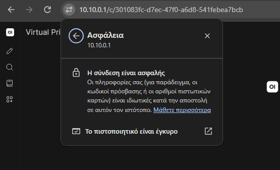

## 8. Secretless secret access (Key Vault and Managed Identity)

**Goal:** prove that a resource can read a secret from Azure with no password, connection string, or key ever stored on disk.

- Key Vault `kv-seclab-18235`, Standard tier, Sweden Central, **RBAC-based access model** (not the older vault access-policy model). This means Key Vault permissions are ordinary RBAC role assignments, consistent with every other access decision in this project, rather than a separate permission system.
- Being subscription Owner does **not** grant access to secrets. I assigned myself **Key Vault Secrets Officer** (manage secrets) on the vault explicitly, and separately assigned the VM's identity **Key Vault Secrets User** (read-only). Two different roles for two different needs, on the same object, is the RBAC model working as intended.
- A test secret (`demo-secret`) was created as a stand-in for a real credential.
- The VM's existing system-assigned managed identity was granted **Key Vault Secrets User** on the vault. This is deliberately narrower than the Officer role: the VM can read a secret's value but cannot list, create or delete secrets.

**Proof, run from the VM over the WireGuard tunnel:**

```bash
# Azure CLI is not in Ubuntu's default repos; Microsoft's script adds
# its own package source and installs it
curl -sL https://aka.ms/InstallAzureCLIDeb | sudo bash

# Authenticate as the VM itself, not a person. No browser, no
# username or password: the CLI fetches a token from Azure's internal
# metadata endpoint, reachable only from inside the VM.
az login --identity

# Read the secret using that identity's token
az keyvault secret show \
  --vault-name kv-seclab-18235 \
  --name demo-secret \
  --query value -o tsv
```

Result: `az login --identity` returns a session where `user.type` is `servicePrincipal` and `assignedIdentityInfo` is `MSI` (Managed Service Identity), confirming the VM authenticated as itself, not as me. `az keyvault secret show` then returns the secret's plaintext value with nothing entered by hand.

At no point in this flow does any file on the VM contain a password, key, or connection string. The only thing that exists is a short-lived token, issued because the VM's identity has been granted a specific, narrow role.

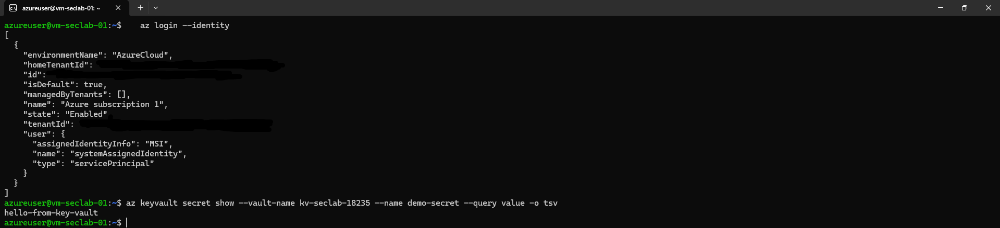
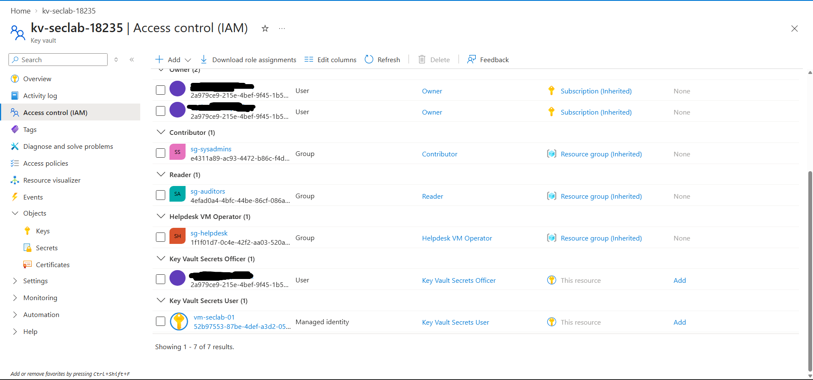

---

## Security decisions

1. **Least privilege** for identities (groups, custom role, resource-group scope) and for the network (port bindings, `AllowedIPs /32`, NSG source restricted to one IP).
2. **No stored secrets** for the VM's Azure access (managed identity) and key-based SSH instead of passwords.
3. **Defence in depth:** NSG, WireGuard keys, `AllowedIPs`, and service port bindings are independent layers.
4. **Nothing exposed at home:** no router port forwarding, since the workstation initiates the tunnel.
5. **Only one internet-facing port:** UDP 51820, restricted to a single source address.
6. **Local inference:** prompts and data never leave my hardware, unlike calling a hosted AI API.
7. **Observe and verify:** logs were used to check the design, not only to collect data (see the finding below).
8. **No secrets on disk:** the VM authenticates to Key Vault with a short-lived token from its own managed identity, never a stored credential.

---

## Finding: exposed SSH discovered through the logs

While querying `Syslog`, I saw repeated `sshd ... Connection closed by authenticating user root <ip> [preauth]` messages every few minutes from unfamiliar addresses. These were internet scanners trying to log in as `root`.

- **Cause:** the VM creation wizard had added a default rule `default-allow-ssh` (TCP 22, source Any). My intended "SSH from my IP only" rule was never actually created, so my design assumption was wrong.
- **Impact:** limited, since the VM accepts SSH keys only and every attempt failed before authentication, but the exposure was unnecessary.
- **Fix:** verified I could still SSH through the tunnel (`10.10.0.1`), deleted `default-allow-ssh`, then proved that a connection to the public IP on port 22 timed out.
- **Verification:** the KQL count of pre-auth attempts dropped to zero after the rule was removed, and my later SSH logins showed source `10.10.0.2` (the tunnel) instead of my public IP.

Lesson: never assume a control exists. Verify it with evidence.

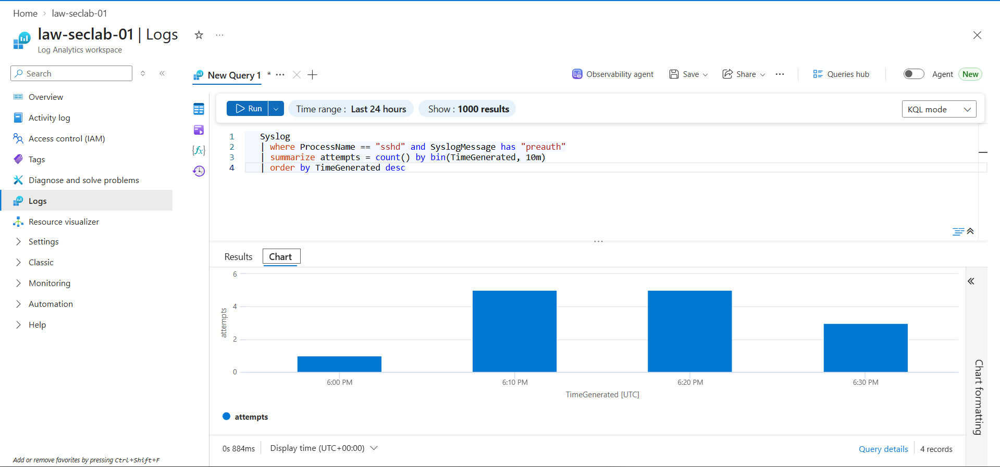
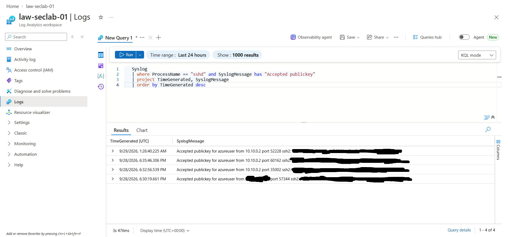

---

## Troubleshooting log

| # | Problem | Cause | Resolution |
|---|---|---|---|
| 1 | Wanted a more professional `.onmicrosoft.com` domain | The initial domain of a tenant created from a personal account cannot be renamed. The Microsoft 365 admin center refuses consumer-created tenants | Kept the default and redact it in documentation. Options were a purchased custom domain or a new tenant |
| 2 | B1s (free tier VM size) not offered | Not available for this subscription and region | Used B2ats_v2, a few euros per month, covered by trial credit, with deallocation between sessions |
| 3 | VM deployment failed: "region not accepting new customers" | Capacity restriction on West Europe for new subscriptions | Deployed to Sweden Central. The resource group keeps its original region label (metadata only), which is a valid configuration |
| 4 | Open WebUI login rejected, then `ERR_SOCKET_NOT_CONNECTED` | Wrong credentials, then the container was still starting after recreation (`health: starting`) | Waited for `(healthy)`. Startup can take several minutes. Credentials must be saved this time |
| 5 | Chrome `ERR_CONNECTION_TIMED_OUT` on `https://10.10.0.1` | The tunnel existed only inside WSL. Windows had no route | Added Windows as a separate WireGuard peer (`10.10.0.3`) |
| 6 | `ERR_CERT_AUTHORITY_INVALID` in Chrome | Caddy's root CA was not in the Windows trust store (the first import did not complete) | Imported with `certutil -user -addstore Root` and restarted Chrome |
| 7 | WireGuard Windows config rejected: "illegal base64 data" | A placeholder was left in the `PrivateKey` line | Replaced it with the real generated key |
| 8 | Internet scanners hitting SSH | Default NSG rule from the VM wizard | See "Finding" above |

---

## Cost control

- Budget alert created before deploying resources.
- VM is stopped (deallocated) from the portal after each session. Stopping from inside the OS keeps billing.
- The LLM runs on my own GPU, so no cloud GPU cost.
- The B-series v1 free-tier size was unavailable, so the small B2ats_v2 was used within trial credit.

---

## Limitations and next steps

Being explicit about scope:

- The tunnel to the workstation exists only while `wg-quick` is up. Docker's `restart: unless-stopped` can start containers before `wg0` exists after a reboot. Automating the order (systemd unit or a startup script) is a next step.
- The LLM stack only works while the workstation is on. This is a lab, not a service.
- One 8 GB GPU serves a few users at most, since requests queue.
- **Not implemented yet:** Privileged Identity Management (needs Entra P2 trial), backups (planned: restic to Azure Blob with a tested restore), forwarding the workstation's Docker logs to Log Analytics, and infrastructure as code.
- The Key Vault demo uses a placeholder secret. A next step would be moving something the stack actually uses (for example, a future database password for a persistence layer) into the vault for real, rather than a dummy value.
- Version pinning of container images.

---

## Operating procedures

### Start the lab
1. Azure portal: `vm-seclab-01` -> **Start**. Check that the public IP has not changed (if it has, update `Endpoint` in the client WireGuard configs).
2. WSL: `sudo wg-quick up wg0`, then `cd ~/llm-stack && docker compose up -d`. Wait for `(healthy)`.
3. Windows: activate the WireGuard tunnel.
4. VM: `sudo wg show` shows both peers with recent handshakes.

### Stop the lab
1. `docker compose stop` (optional) and `sudo wg-quick down wg0`.
2. Azure portal: `vm-seclab-01` -> **Stop** (confirm "Stopped (deallocated)").

### Add a user to the tunnel
1. Client generates a key pair (the private key never leaves the client).
2. Add a `[Peer]` block to `/etc/wireguard/wg0.conf` on the VM with the client's public key and a new `/32` address.
3. Apply: `sudo bash -c 'wg syncconf wg0 <(wg-quick strip wg0)'`.
4. Client config: `Address`, the VM's public key, `Endpoint`, `AllowedIPs = 10.10.0.1/32`, `PersistentKeepalive = 25`.
5. Remove access by deleting the peer block and syncing again.

### Check certificate expiry
```bash
curl -kv https://10.10.0.1 2>&1 | grep expire
```
The date advances automatically as Caddy renews. To verify trust properly, use `curl --cacert root.crt -I https://10.10.0.1`.

### Investigate SSH activity
Run the KQL queries from the logging section in `law-seclab-01` -> Logs.

## Repository contents

```
README.md
screenshots/            # evidence images (redacted)
docker-compose.yml      # LLM stack (ports bound to loopback and tunnel)
Caddyfile               # reverse proxy config (no secrets)
```

